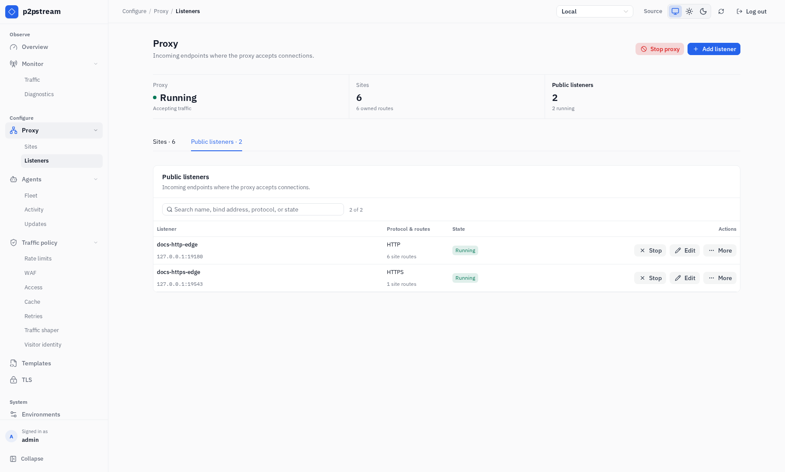

# Docker Compose Details

Run the p2pstream server container with persistent `/data`, explicit management URL settings, and only the host ports you intend to expose.

## Use This When

Use this page after the quickstart when you need to change ports, understand what the Compose file does, or operate the container lifecycle.

## Prerequisites

- The release deployment package prepared by the [quickstart](./quickstart), with `compose.yaml` and a digest pin in `.env`.
- The private `.env` created during release preparation, with your management URL and settings.
- A decision about which host ports should reach container ports `80`, `443`, and `8081`.

## Steps

1. Review the included release `compose.yaml`:

   ```yaml
   services:
     p2pstream:
       image: "${P2PSTREAM_IMAGE:?Run verified release deployment preparation first}"
       container_name: p2pstream
       restart: unless-stopped
       read_only: true
       security_opt:
         - no-new-privileges:true
       cap_drop:
         - ALL
       cap_add:
         - NET_BIND_SERVICE
       tmpfs:
         - /tmp:rw,nosuid,nodev,mode=1777
       environment:
         CONFIG_DIR: /data
         MANAGEMENT_PORT: "8081"
         MANAGEMENT_BIND_ADDRESS: "${MANAGEMENT_BIND_ADDRESS:-0.0.0.0}"
         MANAGEMENT_UI_DISABLED: "${MANAGEMENT_UI_DISABLED:-false}"
         MANAGEMENT_PUBLIC_URL: "${MANAGEMENT_PUBLIC_URL:-https://localhost:8081}"
         MANAGEMENT_TLS_EXTRA_HOSTS: "${MANAGEMENT_TLS_EXTRA_HOSTS:-}"
       ports:
         - "${P2PSTREAM_HTTP_PORT:-80}:80"
         - "${P2PSTREAM_HTTPS_PORT:-443}:443"
         - "${P2PSTREAM_MANAGEMENT_PUBLISH_ADDRESS:-}:${P2PSTREAM_MANAGEMENT_PORT:-8081}:8081"
       volumes:
         - p2pstream-data:/data

   volumes:
     p2pstream-data:
       name: p2pstream-data
   ```

2. Set the externally reachable management URL:

   ```dotenv
   MANAGEMENT_PUBLIC_URL=https://proxy.example.com:8081
   ```

3. Add extra certificate names for auto management TLS when needed:

   ```dotenv
   MANAGEMENT_TLS_EXTRA_HOSTS=proxy.example.com,192.0.2.10
   ```

4. Override host ports only when the defaults are not usable:

   ```dotenv
   P2PSTREAM_HTTP_PORT=8080
   P2PSTREAM_HTTPS_PORT=8443
   P2PSTREAM_MANAGEMENT_PORT=9443
   MANAGEMENT_PUBLIC_URL=https://proxy.example.com:9443
   ```

   Management publishing defaults to all available host interfaces to support remote
   agents. To accept management connections only through a local reverse proxy or
   SSH tunnel, set `P2PSTREAM_MANAGEMENT_PUBLISH_ADDRESS=127.0.0.1`. Ensure agents
   can still reach management HTTPS through that proxy or tunnel. Keep
   the default `MANAGEMENT_BIND_ADDRESS=0.0.0.0` **inside** the container so Docker
   forwarding works. Existing explicit overrides remain supported: a container
   loopback bind prevents Docker forwarding and remote agent access. The container
   listener is separate from the host publish address. Restrict public management
   access with host firewall rules when remote access is required.

5. Start the container:

   ```bash
   docker compose up -d
   docker compose logs -f p2pstream
   ```

## Apply configuration changes

The Compose file and `.env` belong to the operator. Edit them directly, validate the configuration, then recreate the service:

```bash
docker compose config --quiet
docker compose up -d
docker compose ps
```

Keep `P2PSTREAM_IMAGE` at its current digest during settings changes. To disable the browser UI, set `MANAGEMENT_UI_DISABLED=true` in `.env` and run `docker compose up -d`. The management API and agent tunnels remain available.

Software upgrades require an explicit change to the image digest and a backup of application data and deployment inputs. Follow [Upgrades](../operations/upgrades).

## Runtime Effects

| Setting | Effect |
| --- | --- |
| `CONFIG_DIR=/data` | Stores SQLite, certificates, ACME state, and cache defaults in the named volume. |
| `MANAGEMENT_PORT=8081` | Makes the management UI/API and agent tunnel listener bind inside the container. Agents connect to this port for request forwarding. |
| `MANAGEMENT_PUBLIC_URL` | Controls generated links, agent snippets, and management certificate naming. |
| `MANAGEMENT_UI_DISABLED=true` | Stops serving the browser UI; ConnectRPC APIs and the agent Yamux tunnel remain available. |
| `P2PSTREAM_MANAGEMENT_PUBLISH_ADDRESS` | Selects the host address for management publishing; unset preserves all host interfaces, optionally use `127.0.0.1`. |
| `P2PSTREAM_*_PORT` | Changes host-side publishing only; listener ports are still configured in p2pstream. |

The server runs as its existing non-root user with a read-only root filesystem,
a writable `/data` volume and temporary `/tmp`. It drops all capabilities except
`NET_BIND_SERVICE` for ports such as `80` and `443`, and prevents privilege gain
with `no-new-privileges`. Store persistent files under `/data`; custom cache,
certificate or other output paths need an explicit writable mount.

:::warning New listeners must be published explicitly
Docker only exposes ports listed under `ports`. Apply port changes with `docker compose up -d`. If you create an additional listener on container port `8088` under **Proxy -> Listeners**, it will bind inside the container but remain unreachable until you add it to the Compose port list and restart:

```yaml
ports:
  - "${P2PSTREAM_HTTP_PORT:-80}:80"
  - "${P2PSTREAM_HTTPS_PORT:-443}:443"
  - "${P2PSTREAM_MANAGEMENT_PUBLISH_ADDRESS:-}:${P2PSTREAM_MANAGEMENT_PORT:-8081}:8081"
  - "8088:8088"
```
:::

## Verification

Run:

```bash
docker compose ps
docker compose logs -f p2pstream
```

Then open `MANAGEMENT_PUBLIC_URL` in a browser. The **Overview** page should show proxy state, listeners, routes, targets, TLS counts, and recent traffic once requests arrive.

<figure class="doc-screenshot">
  
  <figcaption>The Proxy Listeners page shows each listener's bind address, protocol, routes, and state. If you add another listener, publish that container port in Compose before expecting external traffic.</figcaption>
</figure>

## Troubleshooting

| Symptom | Check |
| --- | --- |
| Browser opens the wrong host or port | `MANAGEMENT_PUBLIC_URL` must match the external URL. |
| Agent cannot connect | Agent must reach management HTTPS/TLS and `/agent/tunnel`, not a public listener URL. |
| Extra listener is unreachable | Add a Compose port mapping for that listener port. |
| Forgot the admin password | Run `docker compose exec p2pstream p2pstream users reset-password admin`. |

## Next Steps

- [Manual server upgrades](../operations/upgrades)
- [Backup and restore](../operations/backup-restore)
- [Docker reference](../reference/docker)
- [Management TLS reference](../reference/management-tls)
