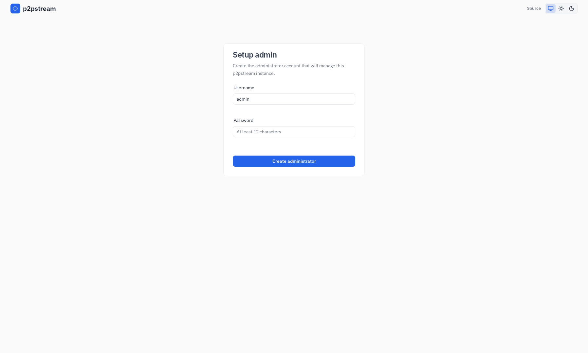

# Docker Compose Quickstart

Start p2pstream with Docker Compose, persist runtime state in the `p2pstream-data` volume, and open the management UI over HTTPS.

## Use This When

Use this path for the normal self-hosted server deployment on a VPS, home lab host, or small private fleet. Compose starts one server container with the management UI/API on `8081`, a seeded HTTP listener on `80`, and a seeded HTTPS listener on `443`.

## Prerequisites

- Linux amd64/arm64 and Docker Engine with the Docker Compose plugin.
- Host ports `80`, `443`, and `8081` available, or adjusted port mappings in `.env`.
- A hostname or IP address that browsers and agents can reach.

## Create two files

Create a directory for the deployment. Save the following as `compose.yaml`:

<<< ../../compose.yaml

Next to it, create `.env`:

```dotenv
MANAGEMENT_PUBLIC_URL=https://your-server:8081
P2PSTREAM_IMAGE=ghcr.io/kirari04/p2pstream:latest
P2PSTREAM_HTTP_PORT=80
P2PSTREAM_HTTPS_PORT=443
P2PSTREAM_MANAGEMENT_PORT=8081
```

Replace `your-server` with your reachable hostname or IP. Use `ghcr.io/kirari04/p2pstream:staging` for prereleases, or select an exact published version tag or digest. The [Docker reference](../reference/docker) describes the channels.

No installer, Python, host updater, or `release.json` is required. The two files belong to you and can be edited directly.

## Start the server

Run from that directory:

```bash
docker compose up -d
docker compose logs -f p2pstream
```

Open `https://your-server:8081`. The management server uses HTTPS by default. It creates a local management CA and server certificate under `/data/certs/management`; browsers warn until you trust that CA or place management behind trusted TLS. The startup log contains the initial admin setup token unless you supplied `MANAGEMENT_SETUP_TOKEN`.

## Configure and upgrade

Edit `.env` or `compose.yaml`, then run `docker compose up -d` to apply settings. To disable the browser UI while keeping the management API and agents available, set `MANAGEMENT_UI_DISABLED=true` in `.env`.

To update the selected channel, keep the same files and data volume:

```bash
docker compose pull p2pstream
docker compose up -d p2pstream
```

Supported database migrations run automatically at startup. Back up before upgrading and read [Upgrades](../operations/upgrades) for compatibility notes. An exact version tag or digest stays pinned until you change `P2PSTREAM_IMAGE`.

If an old server updater still manages the deployment, follow [its transition procedure](../operations/upgrades#leave-server-updater-enrollment). If only abandoned updater metadata remains in a standalone deployment, [the normal image upgrade handles it](../operations/upgrades#standalone-deployments-with-leftover-updater-state) without deleting markers or repairing Compose.

## Verification

The first browser visit should show **Setup admin**. After setup, **Overview** should load. **Proxy -> Listeners** shows the seeded `public-http` and `public-https` listeners. Open their shared published default site under **Proxy -> Sites** to inspect its welcome route and static target. Create a separate draft site for your application's hostnames, configure its routes inside the site workspace, review readiness, and publish when ready.

<figure class="doc-screenshot">
  
  <figcaption>The first-run setup screen appears only before the initial admin user exists. Use the setup token from the configured environment or server startup log.</figcaption>
</figure>

Default sites handle hostnames that no named site owns. A published named site keeps its own routing boundary, including when a path has no matching route. See [Sites](../reference/sites) for listener assignments, publication, and migration of older routing configurations.

On a new database, p2pstream seeds:

| Object | Default |
| --- | --- |
| HTTP listener | `public-http` on `:80` |
| HTTPS listener | `public-https` on `:443` |
| Routes | default catch-all routes with static welcome targets |
| HTTPS fallback certificate | self-signed mapping for `localhost` |

The seeded static targets serve a local `Welcome to p2pstream proxy` page. Replace them or add more specific routes before publishing real traffic.

## Troubleshooting

| Symptom | Check |
| --- | --- |
| Browser cannot connect | Confirm `docker ps`, host firewall, and `P2PSTREAM_MANAGEMENT_PORT`. |
| Certificate warning | Expected with auto management TLS until the generated CA is trusted. |
| Agent snippets use the wrong URL | Fix `MANAGEMENT_PUBLIC_URL` in `.env`, then run `docker compose up -d`. |
| Public listener does not answer | Confirm the listener exists under **Proxy -> Listeners**, is enabled and running, and its port is published by Compose. |

See [Troubleshooting](../operations/troubleshooting) for route, TLS, agent, and cache-specific checks.

## Next Steps

- [First login](./first-login)
- [Docker Compose details](./docker-compose)
- [Publish a service](../guides/publish-a-service)
